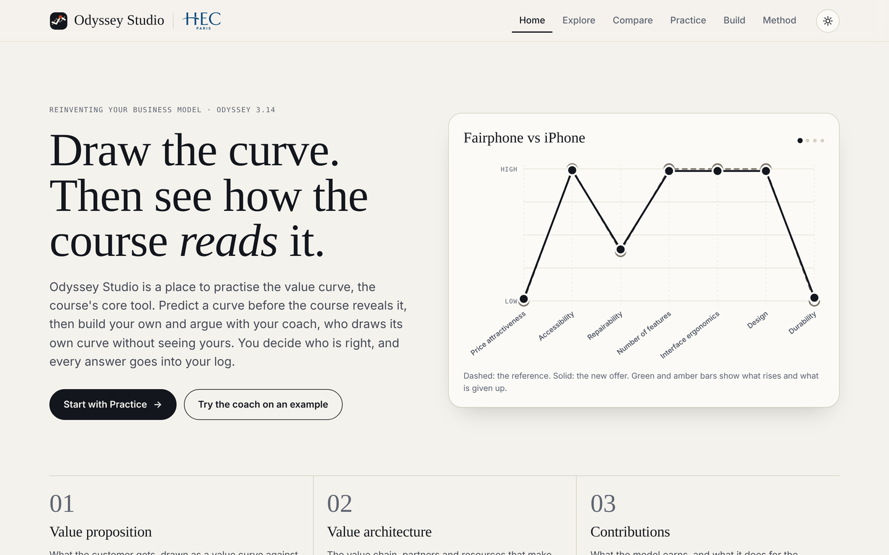
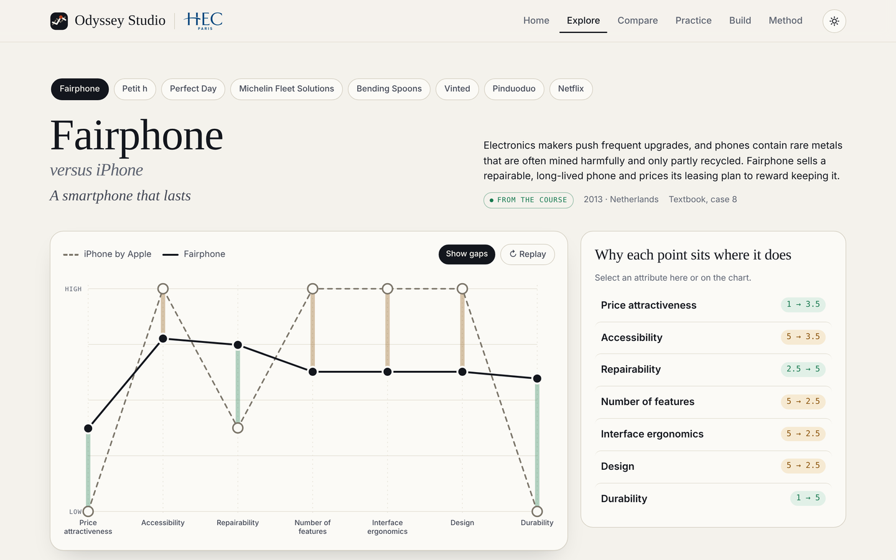
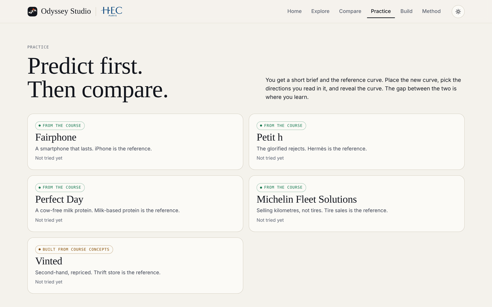
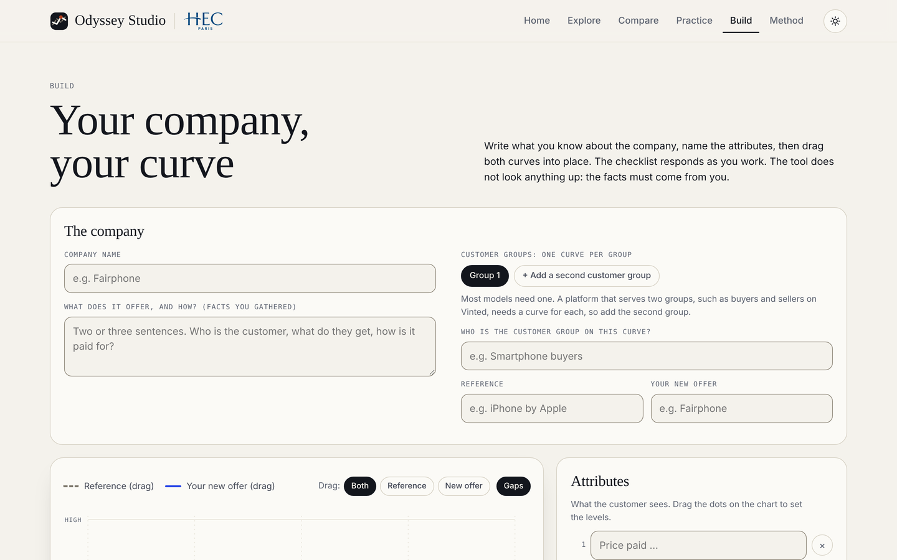

# Odyssey Studio: learn a strategy tool by predicting, then comparing

**Live:** [odyssey-studio-seven.vercel.app](https://odyssey-studio-seven.vercel.app) · **Role:** solo, covering concept, UX, visual design and build · **Context:** HEC Paris, *Reinventing Your Business Model (Odyssey 3.14)*, Sept–Oct 2026



## The problem

The value curve is the core tool of the course. It compares a new offer with a reference on the attributes customers care about. In class you watch curves being *explained*, but you rarely get to *draw* one and find out whether your reading holds up. Reading cases is passive, and the gap between "I understand it" and "I can do it" only shows up in the exam.

**Users:** my classmates, preparing for assignments and the exam.

## Design principles

- **Predict before you see the answer.** Practice mode gives you a short brief and the reference curve. You place the new curve yourself, and only then does the course's curve slide in beside yours. The gap between the two is where you learn.
- **Explain every point.** In Explore, each attribute on the chart comes with a sentence on why it sits where it does, and gaps can be shown or hidden.
- **The AI coach goes second, and you have the last word.** In Build, the student describes a company and places both curves while a rule-based checklist reacts live. Then the AI coach draws its own curve without seeing the student's. For each disagreement the student must accept or reject the coach's reading, *with a reason*. The thinking stays with the student.
- **The tool never invents facts.** Build doesn't look anything up: the facts about the company have to come from the student.

## The experience

**Explore:** eight cases. Four come from the textbook, one is a student analysis (Bending Spoons), and three are built from course concepts.


**Practice:** predict first, then compare.


**Build:** your company, your curve, with a live checklist and an AI coach that has to argue its case.


> A student project built on the course framework and cases. Not an official HEC tool.

---

# Technical notes

## Structure

```
index.html        the whole front end (no build step)
api/ai.js         Vercel serverless function that calls Gemini
api/_course.js    the course frame sent to Gemini (rules, 14 directions, textbook curves)
```

The browser never sees the API key. It sends only the company facts and the curve to `/api/ai`; the prompts are built on the server, so the endpoint cannot be used as a free general-purpose Gemini proxy. The function also accepts same-origin requests only and rate-limits each IP (best effort).

## Deploy on Vercel

1. Import this repository in Vercel (framework preset: **Other**, no build command, no output directory).
2. In **Settings → Environment Variables** add:
   - `GEMINI_API_KEY` — your key from Google AI Studio (required)
   - `GEMINI_MODEL` — optional (default: `gemini-3.6-flash`, then `gemini-2.5-flash`, then `gemini-flash-latest`)
   - `AI_RATE_LIMIT` — optional, requests per IP every 10 minutes (default `12`)
3. Redeploy so the variables take effect, then add your domain in **Settings → Domains**.

## Run locally

```
npm i -g vercel
vercel dev
```

Put `GEMINI_API_KEY=...` in a `.env.local` file (already git-ignored).
